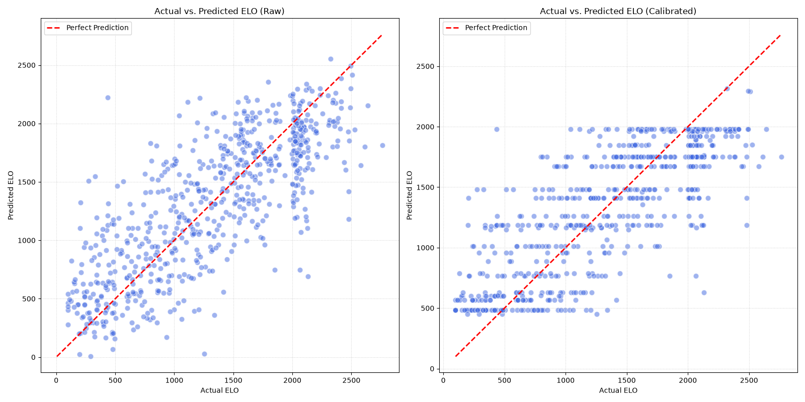
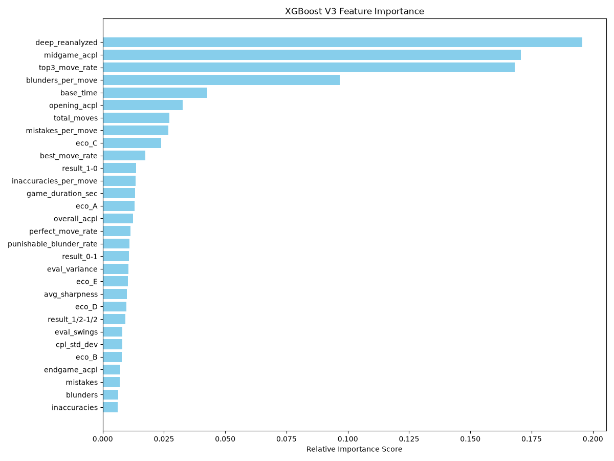
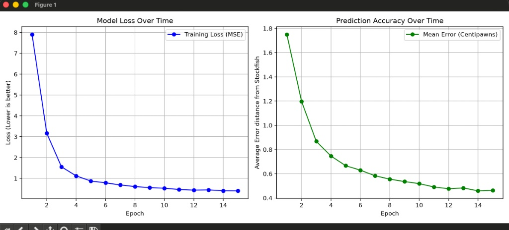

# ♟️ Chess ML Toolkit: ELO Predictor & CNN Solver

A comprehensive machine learning pipeline that analyzes chess games, predicts player skill levels, and evaluates board positions. This project features a dual-model architecture (XGBoost + PyTorch) served via a modern REST API.

---

## 👥 Contributors

This project was built as a joint, 50/50 collaborative effort:

*   **[Bărbulescu Alexandra]** ([@meca-mica](https://github.com/meca-mica)) – Core developer for the **PyTorch CNN Evaluator**. Engineered the custom Convolutional Neural Network, FEN tensor translation, and spatial pattern recognition.
*   **[Prodan Eric-Alexandru]** ([@cire1773](https://github.com/cire1773)) – Core developer for the **XGBoost ELO Predictor**. Engineered the parallel Stockfish feature extraction, adaptive depth system, and isotonic calibration pipeline.

---

## 🚀 Key Features

*   **XGBoost ELO Predictor (V3):** A regression model that predicts a player's ELO rating based on their move history. It utilizes parallel Stockfish processing to extract 19 advanced features—such as centipawn loss, blunder rates, and evaluation swings. The V3 pipeline includes an adaptive depth system and Isotonic Calibration to ensure highly accurate predictions across all skill brackets.
*   **PyTorch CNN Evaluator:** A custom Convolutional Neural Network trained on a Kaggle dataset to evaluate static board positions. It translates FEN strings into 12x8x8 tensor representations for spatial pattern recognition (e.g., forks and pins) without relying on traditional engines.
*   **Minimax Puzzle Solver:** Integrates the trained CNN with a custom Minimax algorithm (featuring alpha-beta pruning) to calculate optimal moves and detect forced mates directly from board states.
*   **FastAPI Backend:** Provides robust REST API endpoints (`/predict_elo` and `/solve_position`) allowing external applications to seamlessly interface with both machine learning models.

---

## 📊 Model Performance

### XGBoost ELO Predictor (V3)
The V3 ELO prediction model successfully mitigates regression-to-the-mean biases found in earlier versions through post-hoc isotonic calibration.

**Actual vs. Predicted ELO**

*The scatter plot demonstrates the tighter clustering of predictions along the ideal diagonal line after calibration, particularly improving accuracy at the extreme high and low ELO ranges.*

**Feature Importance**

*The model heavily weighs `deep_reanalyzed`, `midgame_acpl`, and `top3_move_rate` to separate advanced players from beginners.*

### PyTorch CNN Evaluator
The Convolutional Neural Network was trained over 15 epochs to evaluate static board positions, learning to match Stockfish evaluations directly from FEN tensor representations.

**Training Metrics Over Time**

*   **Model Loss (Left):** The Mean Squared Error (MSE) drops sharply in the first few epochs, stabilizing well below 1.0, indicating efficient learning of complex positional evaluations.
*   **Prediction Accuracy (Right):** The Mean Absolute Error steadily decreases throughout training, reaching an average error distance of less than 0.5 pawns (~50 centipawns) from the true Stockfish evaluation.

---

## ⚙️ Installation & Setup

**1. Clone the repository**
~~~bash
git clone https://github.com/cire1773/Elo-Guesser-ML.git
cd Elo-Guesser-ML
~~~

**2. Install dependencies**
Install all required Python packages using `pip`:
~~~bash
pip install pandas numpy xgboost scikit-learn matplotlib chess torch torchvision fastapi uvicorn python-multipart chessimg2pos
~~~

**3. Configure Stockfish**
*   Download the appropriate [Stockfish binary](https://stockfishchess.org/download/) for your operating system.
*   Place the executable in a `./stockfish/` directory within the project root.
*   Ensure the path in the scripts matches your binary's name (e.g., `stockfish-windows-x86-64-avx2.exe` or `stockfish-macos-m1-apple-silicon`).

---

## 💻 Usage

### Starting the API Server
Launch the FastAPI application to serve the models:
~~~bash
uvicorn server:app --reload
~~~
*   **POST** `/predict_elo`: Accepts a JSON payload with PGN moves and returns an estimated ELO, along with blunder and mistake counts.
*   **POST** `/solve_position`: Accepts an uploaded image of a chessboard, extracts the FEN, and uses the CNN + Minimax algorithm to return the best move or mate sequence.

### Training the Models
*   **ELO Predictor:** Run `elo_predictor.py` to process `chess_data.csv` via multi-core Stockfish extraction and train the XGBoost model. 
*   **CNN Evaluator:** Run `predictionv2.py` to train the PyTorch model. The script automatically utilizes hardware acceleration (like Apple Silicon MPS or CUDA) if available.